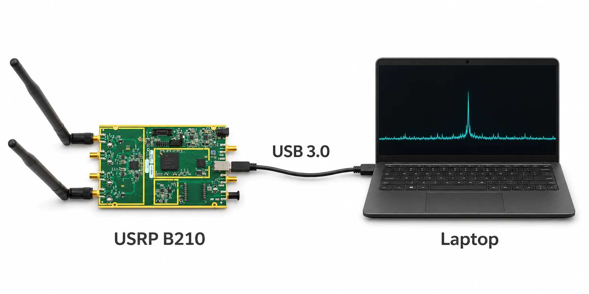
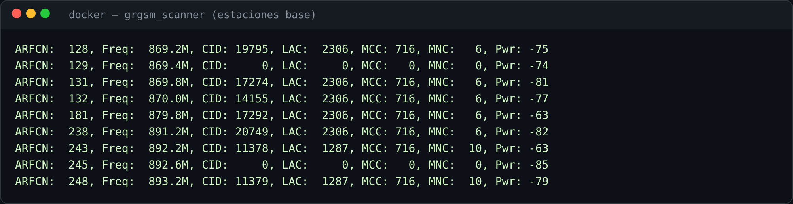

# Hacking RF 101: Sniffando la estación base

Oscar Llerena

Consultor Ciberseguridad · Telecomunicaciones · IA aplicada

<!--
Recepción PASIVA. No se transmite, no se accede a la red, no se descifra tráfico.
Se demuestra una falla de diseño conocida y reportada de 2G: la señalización de
identidad viaja sin protección de confidencialidad. Uso educativo / investigación.
-->

---
layout: pantalla-anim
title: "Punto de partida"
---

  <section class="zona2 z-op">
    Redes Móviles
    

      <carbon-mobile class="ic-big" />
      Teléfono
    

    
1

    

      <carbon-cell-tower class="ic-big" />
      Estación base
      

        <b v-motion :initial="{ opacity: 0 }" :enter="{ opacity: 1, transition: { delay: 1200 } }">5G</b>
        <b v-motion :initial="{ opacity: 0 }" :enter="{ opacity: 1, transition: { delay: 1900 } }">4G</b>
        <b v-motion :initial="{ opacity: 0 }" :enter="{ opacity: 1, transition: { delay: 2600 } }">3G</b>
        <b class="g2" v-motion :initial="{ opacity: 0, scale: 0.6 }" :enter="{ opacity: 1, scale: 1, transition: { delay: 3300, type: 'spring' } }">2G</b>
      

    

  </section>
  <section class="zona2 z-net dim">Recepción pasiva · PC + SDR</section>
  <section class="zona2 z-exp dim">Exposición</section>

GSM, es decir 2G, emite su plano de señalización <strong>sin cifrar</strong>

<!--
En nuestras redes móviles, el acceso lo componen los dispositivos móviles y la
estación base — hoy con infraestructura desplegada para 5G, 4G, 3G e, aún, 2G.
Y resulta que GSM, es decir 2G, emite su plano de señalización (RR/MM) sin cifrar.
-->

---
layout: pantalla-anim
title: "IMSI y TMSI"
acto: "Acto 1 · la identidad"
---

<CanvasZonas>
  <template #redes><RedesMoviles /></template>
</CanvasZonas>

<section class="tarjeta"><h2>IMSI</h2>
identificador permanente del abonado
</section>
<section class="tarjeta lectura"><h2>TMSI</h2>
alias temporal, reasignado por la red
</section>

<!--
GSM no autentica la red hacia el terminal. El TMSI reduce la exposición del IMSI,
pero hay ventanas donde el IMSI viaja en claro (ver Acto 2).
-->

---
layout: pantalla-anim
title: "El IMSI en el paging"
---

  

    

      <carbon-mobile class="ic-big" />
      Teléfono
    

    

      <strong>Paging Request · PCH</strong>
      
      Downlink · difusión a toda la celda
    

    

      <carbon-cell-tower class="ic-big" />
      Estación base
    

  

  <section class="paging-caso paging-tmsi" v-motion :initial="{ opacity: 0, y: 12 }" :enter="{ opacity: 1, y: 0, transition: { delay: 1200, duration: 450 } }">
    
Caso 1<h2>Paging por <strong>TMSI</strong></h2>

    
<strong>IMSI protegido</strong>Se difunde el alias temporal

  </section>
  <section class="paging-caso paging-imsi" v-motion :initial="{ opacity: 0, y: 12 }" :enter="{ opacity: 1, y: 0, transition: { delay: 2500, duration: 450 } }">
    
Caso 2<h2>Paging por <strong>IMSI</strong></h2>

    
<strong>EN CLARO</strong>Identificador permanente expuesto

  </section>
  

    
<strong class="paging-identidad">IMSI</strong>vs<strong class="paging-alias">TMSI</strong>

    
lo que capturamos pasivamente es el <strong>paging por IMSI</strong>

  

<!--
La estación base difunde Paging Request por el PCH hacia toda la celda.
Con TMSI se anuncia un alias temporal: el IMSI no aparece en ese paging.
Con IMSI se anuncia el identificador permanente en claro. La herramienta captura
pasivamente esos IMSIs del paging/PCH, sin transmitir ni solicitar la identidad.
-->

---
layout: pantalla-anim
title: "Un receptor más"
acto: "Acto 1 · la identidad"
---

<CanvasZonas>
  <template #redes><RedesMoviles /></template>
  <template #recepcion>
    
  </template>
</CanvasZonas>

Software-Defined Radio + Linux (Radioconda)

  

    <svg class="fl-wave" viewBox="0 0 84 30" aria-hidden="true"><path d="M2 15 Q 12 1 22 15 T 42 15 T 62 15 T 82 15" fill="none" stroke="currentColor" stroke-width="2.6" /></svg>
    Señal de radio
  

  demodula →
  

    <code class="fl-bits">0 1 0 1 1 0</code>
    Bits
  

  framing →
  

    Canales
    BCCH · CCCH
  

<!--
El downlink es un broadcast a toda la celda; un receptor pasivo capta lo mismo sin
emitir nada. El SDR + Linux (Radioconda) entrega la señal; el software la demodula
a bits y los organiza (framing) en canales lógicos.
-->

---
layout: pantalla-anim
title: "Demodulación"
---

<CanvasZonas>
  <template #redes><RedesMoviles /></template>
  <template #recepcion>
    

      
      
gr-gsm · GNU Radio

      
    

  </template>
</CanvasZonas>

<!--
En el PC, gr-gsm (GNU Radio) sintoniza la ARFCN y demodula GMSK; grgsm_scanner
lista las celdas activas (ARFCNs). La señalización decodificada sale como GSMTAP.
-->

---
layout: pantalla-anim
title: "Canales de señalización abiertos"
---

<CanvasZonas>
  <template #redes><RedesMoviles /></template>
  <template #recepcion>
    

      

        <carbon-unlocked class="canal-ic" />
        
<b>BCCH</b>System Information

        abierto
      

      

        <carbon-unlocked class="canal-ic" />
        
<b>CCCH · PCH</b>Paging

        IMSI aquí
      

      

        <carbon-unlocked class="canal-ic" />
        
<b>SDCCH</b>MM · location update

        abierto
      

      

      

        <carbon-locked class="canal-ic" />
        
<b>TCH</b>Tráfico · voz / datos

        A5/x cifrable
      

    

  </template>
</CanvasZonas>

  
La señalización de identidad temprana viaja <strong>sin cifrar</strong>. El tráfico puede cifrarse (A5/x), pero el <strong>IMSI ya salió</strong> por el paging.

<!--
BCCH/CCCH transportan los procedimientos de Mobility Management. El IMSI se expone
cuando ocurre un location update sin TMSI aún asignado, o un paging/identity por
IMSI, ANTES de la reasignación del TMSI. El canal de tráfico puede cifrarse (A5/x);
la señalización de identidad temprana es la que queda observable. Acto 2 termina
aquí: los canales abiertos son el puente al Acto 3.
-->

---
layout: pantalla
title: "Del canal a GSMTAP"
acto: "Acto 3 · extracción"
scene: C08
---

<!--
Los paquetes GSMTAP llegan a lo:4729. GSMEvil2 (pyshark) los sniffea y parsea la
señalización GSM_A.CCCH.
-->

---
layout: pantalla
title: "IMSI en claro"
acto: "Acto 3 · extracción"
scene: C09
---

Un identificador permanente, extraído sin transmitir nada.

<!--
El momento central: del paging/identity request sale el IMSI del abonado, en claro.
"Este teléfono estuvo en el alcance de la antena."
-->

---
layout: pantalla
title: "No es un abonado"
acto: "Acto 4 · escala"
scene: C10
---

<!--
Sobre una ventana de captura se acumulan miles de IMSIs únicas. La escala convierte
una curiosidad en un problema de privacidad masivo.
-->

---
layout: pantalla
title: "Roamers por MCC"
acto: "Acto 4 · escala"
scene: C11
---

USA · España · Liechtenstein · Chile · Argentina · …

<!--
El MCC/MNC del IMSI es la red de origen del abonado. Un MCC != 716 (Perú) = roamer.
Datos reales de la captura: decenas de roamers de distintos países.
-->

---
layout: pantalla
title: "Presencia en el tiempo"
acto: "Acto 4 · escala"
scene: C12
---

<!--
La misma IMSI reaparece: primera y última vez vista. Eso es rastreo de presencia de
un individuo, no solo su nacionalidad.
-->

---
layout: pantalla
title: "La interfaz"
acto: "Acto 4 · escala"
---

  <figure><figcaption>/imsi/ · tabla en vivo</figcaption></figure>
  <figure><figcaption>/analytics/ · roamers y presencia</figcaption></figure>

<!--
GSMEvil2 + panel propio: /imsi/ (tabla en vivo), /analytics/ (combos MCC/MNC,
roamers marcados, presencia) y /search/ (¿está tu IMSI entre las capturadas?).
Demo real corriendo en Docker con el B210.
-->

---
layout: pantalla
title: "Falla conocida y reportada"
acto: "Acto 5 · contexto"
scene: C14
---

<!--
La cadena completa. Nada de esto es nuevo: ausencia de autenticación mutua, A5/1
roto hace años, IMSI catchers documentados. Falla de diseño de 2G, reportada hace
décadas. El punto: 2G sigue en servicio en muchas redes.
-->

---
layout: pantalla
title: "Defensa"
acto: "Acto 5 · contexto"
---

<section class="tarjeta"><carbon-security />
Apagar 2G (sunset)
</section>
<section class="tarjeta"><carbon-locked />
TMSI/GUTI y re-cifrado de identidad
</section>
<section class="tarjeta"><carbon-checkmark-filled />
5G SUCI: identificador cifrado
</section>

<!--
Mitigaciones: apagado de 2G por los operadores; uso correcto del TMSI; y, de raíz,
el SUCI de 5G cifra el identificador permanente (SUPI) con la clave pública de la red.
-->

---
layout: pantalla
title: "Cierre"
acto: "Acto 5 · contexto"
---

Recepción pasiva

Canales abiertos

Falla aún no resuelta

Preguntas

<!--
Alcance claro: recepción pasiva de señalización 2G no protegida, falla documentada.
Preguntas.
-->
