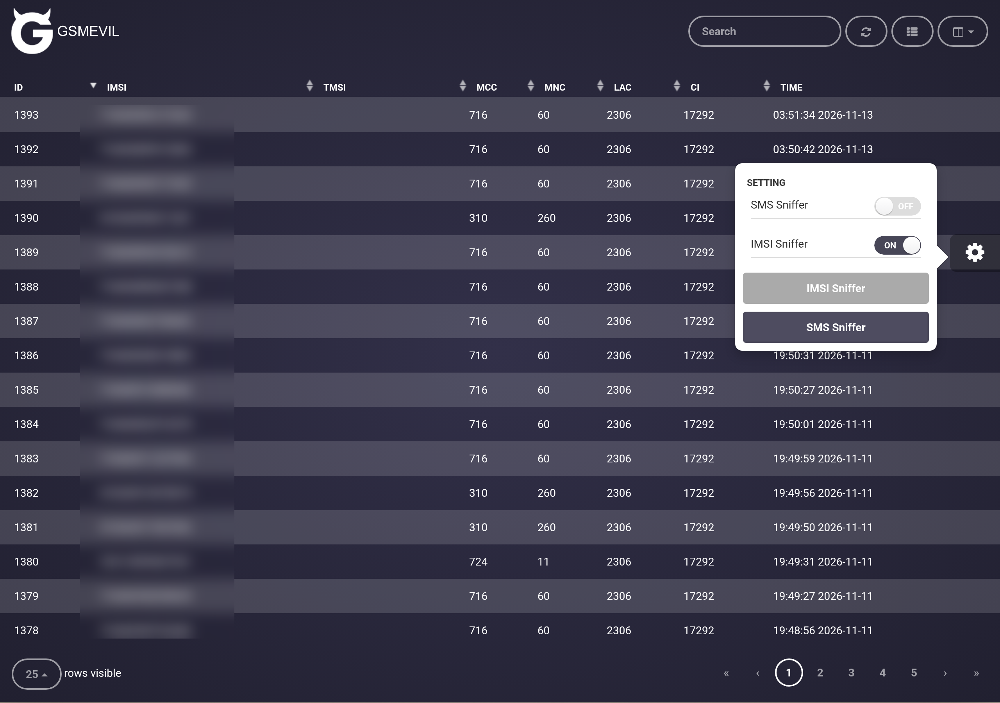
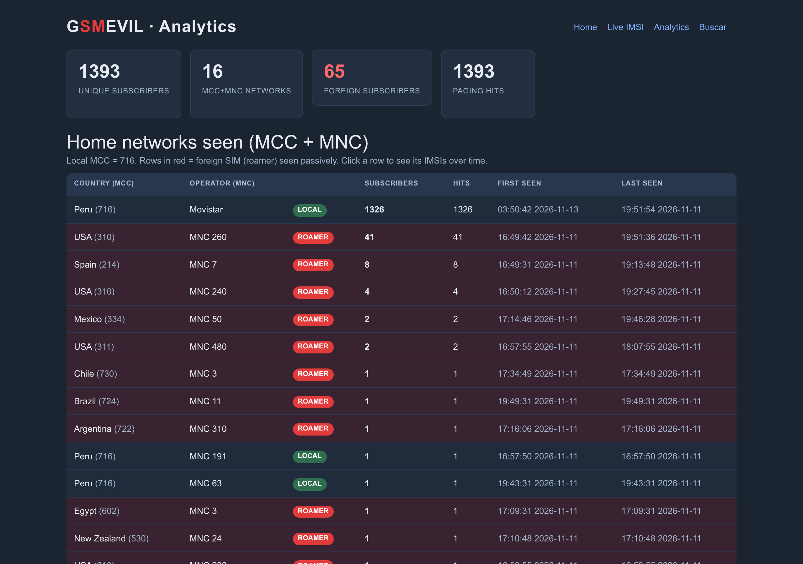

# Hacking RF 101: Sniffando la estación base

Oscar Llerena

Consultor Ciberseguridad · Telecomunicaciones · IA aplicada

<!--
Recepción PASIVA. No se transmite, no se accede a la red, no se descifra tráfico.
Se demuestra una falla de diseño conocida y reportada de 2G: la señalización de
identidad viaja sin protección de confidencialidad. Uso educativo / investigación.
-->

---
layout: pantalla
title: "Punto de partida"
acto: "Acto 0 · el enlace"
scene: C02
---

<!--
Un teléfono y la estación base 2G intercambian señalización (RR/MM). El plano de
control de GSM se emite sin cifrar: cualquier receptor en rango lo demodula.
-->

---
layout: pantalla
title: "IMSI y TMSI"
acto: "Acto 1 · la identidad"
scene: C03
---

<section class="tarjeta"><h2>IMSI</h2>
identificador permanente del abonado
</section>
<section class="tarjeta lectura"><h2>TMSI</h2>
alias temporal, reasignado por la red
</section>

<!--
GSM no autentica la red hacia el terminal. El TMSI reduce la exposición del IMSI,
pero hay ventanas donde el IMSI viaja en claro (ver Acto 2).
-->

---
layout: pantalla
title: "Un receptor más"
acto: "Acto 1 · la identidad"
scene: C04
---

<!--
El downlink es un broadcast a toda la celda. Un receptor pasivo capta exactamente
lo mismo que cualquier teléfono camped en esa celda, sin emitir una sola trama.
-->

---
layout: pantalla
title: "Antena y SDR"
acto: "Acto 2 · setup"
scene: C05
---

<!--
Cadena de recepción: antena → SDR (USRP B210 por USB3, o un RTL-SDR). La SDR
entrega muestras IQ de una porción de la banda GSM (aquí GSM850).
-->

---
layout: pantalla
title: "Demodulación"
acto: "Acto 2 · setup"
scene: C06
---

<!--
En el PC, gr-gsm (GNU Radio) sintoniza la ARFCN de la celda y demodula GMSK.
grgsm_livemon emite la señalización decodificada como GSMTAP.
-->

---
layout: pantalla
title: "Canales de señalización abiertos"
acto: "Acto 2 · setup"
scene: C07
---

<!--
BCCH/CCCH transportan los procedimientos de Mobility Management. El IMSI se expone
cuando ocurre un location update sin TMSI aún asignado, o un paging/identity por
IMSI, ANTES de la reasignación del TMSI. El canal de tráfico puede cifrarse (A5/x);
la señalización de identidad temprana es la que queda observable. Acto 2 termina
aquí: los canales abiertos son el puente al Acto 3.
-->

---
layout: pantalla
title: "Del canal a GSMTAP"
acto: "Acto 3 · extracción"
scene: C08
---

<!--
Los paquetes GSMTAP llegan a lo:4729. GSMEvil2 (pyshark) los sniffea y parsea la
señalización GSM_A.CCCH.
-->

---
layout: pantalla
title: "IMSI en claro"
acto: "Acto 3 · extracción"
scene: C09
---

Un identificador permanente, extraído sin transmitir nada.

<!--
El momento central: del paging/identity request sale el IMSI del abonado, en claro.
"Este teléfono estuvo en el alcance de la antena."
-->

---
layout: pantalla
title: "No es un abonado"
acto: "Acto 4 · escala"
scene: C10
---

<!--
Sobre una ventana de captura se acumulan miles de IMSIs únicas. La escala convierte
una curiosidad en un problema de privacidad masivo.
-->

---
layout: pantalla
title: "Roamers por MCC"
acto: "Acto 4 · escala"
scene: C11
---

USA · España · Liechtenstein · Chile · Argentina · …

<!--
El MCC/MNC del IMSI es la red de origen del abonado. Un MCC != 716 (Perú) = roamer.
Datos reales de la captura: decenas de roamers de distintos países.
-->

---
layout: pantalla
title: "Presencia en el tiempo"
acto: "Acto 4 · escala"
scene: C12
---

<!--
La misma IMSI reaparece: primera y última vez vista. Eso es rastreo de presencia de
un individuo, no solo su nacionalidad.
-->

---
layout: pantalla
title: "La interfaz"
acto: "Acto 4 · escala"
---

  <figure><figcaption>/imsi/ · tabla en vivo</figcaption></figure>
  <figure><figcaption>/analytics/ · roamers y presencia</figcaption></figure>

<!--
GSMEvil2 + panel propio: /imsi/ (tabla en vivo), /analytics/ (combos MCC/MNC,
roamers marcados, presencia) y /search/ (¿está tu IMSI entre las capturadas?).
Demo real corriendo en Docker con el B210.
-->

---
layout: pantalla
title: "Falla conocida y reportada"
acto: "Acto 5 · contexto"
scene: C14
---

<!--
La cadena completa. Nada de esto es nuevo: ausencia de autenticación mutua, A5/1
roto hace años, IMSI catchers documentados. Falla de diseño de 2G, reportada hace
décadas. El punto: 2G sigue en servicio en muchas redes.
-->

---
layout: pantalla
title: "Defensa"
acto: "Acto 5 · contexto"
---

<section class="tarjeta"><carbon-security />
Apagar 2G (sunset)
</section>
<section class="tarjeta"><carbon-locked />
TMSI/GUTI y re-cifrado de identidad
</section>
<section class="tarjeta"><carbon-checkmark-filled />
5G SUCI: identificador cifrado
</section>

<!--
Mitigaciones: apagado de 2G por los operadores; uso correcto del TMSI; y, de raíz,
el SUCI de 5G cifra el identificador permanente (SUPI) con la clave pública de la red.
-->

---
layout: pantalla
title: "Cierre"
acto: "Acto 5 · contexto"
---

Recepción pasiva

Canales abiertos

Falla aún no resuelta

Preguntas

<!--
Alcance claro: recepción pasiva de señalización 2G no protegida, falla documentada.
Preguntas.
-->
